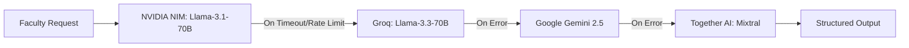
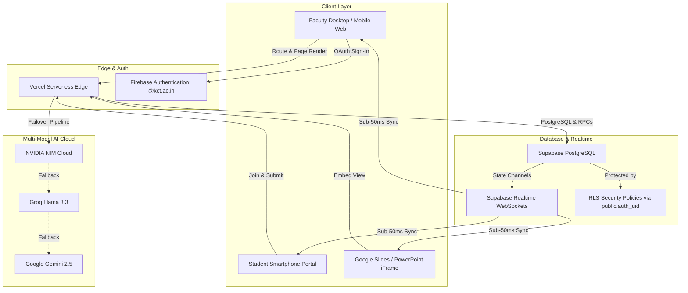

# ⚡ KCT PULSE — Enterprise Classroom Engagement & Telemetry

<div align="center">

[](https://kct-classroom-flow.vercel.app)
[](https://supabase.com)
[](https://firebase.google.com)
[](https://react.dev)
[](https://www.typescriptlang.org)
[](https://kct.ac.in)

**Next-generation real-time classroom interaction, automated telemetry, and pedagogical analytics platform built for Kumaraguru College of Technology (KCT).**

[Explore Live Web App 🚀](https://kct-classroom-flow.vercel.app) • [Faculty Portal 🔑](https://kct-classroom-flow.vercel.app/auth) • [Student Join Portal 📱](https://kct-classroom-flow.vercel.app/join/KCT001) • [Developer Telemetry 📊](https://kct-classroom-flow.vercel.app/developer)

---


</div>

---

## 📖 Table of Contents

1. [Platform Overview & Vision](#-platform-overview--vision)
2. [Complete Documentation Suite](#-complete-documentation-suite-reading-files)
3. [Core Features & Platform Capabilities](#-core-features--platform-capabilities)
4. [Mobile-First Responsive Architecture](#-mobile-first-responsive-architecture)
5. [Multi-Provider AI & Proctoring Intelligence](#-multi-provider-ai--proctoring-intelligence)
6. [Login Telemetry & Audit System](#-login-telemetry--audit-system)
7. [System Architecture & Data Flow](#-system-architecture--data-flow)
8. [Database Schemas & RLS Security Model](#-database-schemas--rls-security-model)
9. [Key Routes & Application Map](#-key-routes--application-map)
10. [Local Development & Environment Setup](#-local-development--environment-setup)
11. [Deployment & Verification](#-deployment--verification)
12. [Project Governance & Contributors](#-project-governance--contributors)

---

## 🌟 Platform Overview & Vision

**KCT PULSE** transforms higher education lectures into dynamic, data-driven active learning environments. By integrating live polling, interactive word clouds, graded quizzes, and slides directly into faculty presentation workflows (Google Slides and Microsoft PowerPoint), KCT PULSE bridges the engagement gap in modern lecture halls.

- **Zero-Friction Student Access:** Students join via 6-character session shortcodes or projector QR codes on any mobile device without account creation, app downloads, or friction.
- **Enterprise Institutional Security:** Faculty authentication is strictly restricted to verified `@kct.ac.in` Microsoft and Google institutional identities.
- **Actionable Classroom Analytics:** Faculty receive automated engagement metrics, weak topic detection, and PDF analytics reports, while campus administrators access real-time system and login telemetry.

---

## 📚 Complete Documentation Suite (Reading Files)

The project includes thorough technical and governance documentation located in the root repository:

| Document File | Purpose & Audience | Key Sections Covered |
| :------------ | :----------------- | :------------------- |
| 📄 [**`CLIENT_HANDOVER_SPEC.md`**](./CLIENT_HANDOVER_SPEC.md) | **Client Specification & Technical Handover Report** for College Administration, HODs, and Stakeholders. | Executive Summary, Core Modules, Infrastructure Benefits, SLA, Domain Governance, and Production Verification. |
| 🏗️ [**`PROJECT_ARCHITECTURE.md`**](./PROJECT_ARCHITECTURE.md) | **Technical Architecture & Developer Reference** for Engineering teams and Contributors. | Tech Stack, Hidden Route Directory, Supabase Postgres Schemas, Background Automation Loops, and API Pipelines. |
| 🎨 [**`DESIGN_SYSTEM.md`**](./DESIGN_SYSTEM.md) | **UI/UX Design System, Design Tokens & Component Specs**. | Color Tokens, Glassmorphism CSS Formulas, Typography (Inter/Plus Jakarta Sans), Elevation Scales, and Animation Curves. |
| 🛡️ [**`SECURITY.md`**](./SECURITY.md) | **Platform Security Policy & Vulnerability Reporting**. | Security Governance, Institutional Domain Enforcement, Inactivity Lifecycles, and Responsible Disclosure. |
| 📋 [**`AGENTS.md`**](./AGENTS.md) | **Autonomous Agent & Lovable Synchronization Rules**. | Git History Integrity, Rebase Constraints, and CI/CD Lovable Editor sync guidelines. |

---

## ✨ Core Features & Platform Capabilities

### 🎓 1. Faculty Command Center (`/dashboard`)
- **Real-Time KPI Suite:** Live session counters, active classroom listeners, total students engaged, questions authored, and overall engagement velocity.
- **Live Database Sync Indicator:** Visual status badge reflecting Supabase WebSocket connection health.
- **One-Click Session Creation:** Rapid modal for generating new subject lectures with unique alphanumeric shortcodes.

### 🗂️ 2. Classroom Sessions & Department Workspaces (`/dashboard/sessions`)
- **Dual Workspace Tabs:** Manage personal faculty sessions alongside curated department templates (CSE, EEE, Maths, Chemistry).
- **Template Cloning:** One-click cloning of pre-curated department question banks into individual faculty workspaces.
- **Session Management:** Rename lectures, delegate co-hosting access to departmental colleagues, or conduct safe deletions.

### 📱 3. Zero-Friction Student Portal (`/join/$code`)
- **Instant Connection:** Real-time synchronization over Supabase WebSockets (< 50ms latency).
- **Interactive Input:** Multi-choice polling, animated word clouds, and graded quizzes.
- **Live Confirmation:** Haptic feedback and confirmation screens upon response submission.

### 📺 4. Slide Presentation Embed View (`/embed/$code`)
- **Frameless Projection Layout:** Designed specifically for seamless embedding into **Google Slides** or **Microsoft PowerPoint** via `iframe`.
- **Integrated Projector QR Code:** High-contrast QR codes for rapid student scanning from back-row auditorium seats.
- **Live Synchronized Visualizations:** Real-time animated bar charts and word cloud morphing as votes arrive.

### 🧠 5. Classroom Intelligence & Pedagogical ML (`/dashboard/intelligence`)
- **Engagement Scoring Algorithm:** Real-time engagement scoring (0–100) combining submission velocity, attendance persistence, and response completeness.
- **Engagement Tiers:** Categorizes student cohorts into 🟢 *Highly Engaged*, 🟡 *Moderately Engaged*, and 🔴 *Needs Attention*.
- **Weak Topic Detection:** Automated identification of concept gaps based on quiz accuracy distributions.

### 🛡️ 6. Security Intelligence & WAF Telemetry (`/dashboard/security`)
- **Layered Defense Telemetry:** Behavioral anomaly detection, rapid response velocity traps, and rate limiting metrics.
- **Edge Security Headers:** Strict CSP, HSTS, X-Content-Type-Options, and frame ancestor restrictions.

### 👨‍💻 7. Developer Telemetry & Faculty Monitoring (`/developer`)
- **Password-Gated Access:** Protected by institutional passkey.
- **Real-Time Login Telemetry:** Comprehensive audit trail of faculty logins, devices, browsers, and session durations.
- **System Health Diagnostics:** Live Supabase database ping latencies, channel subscription metrics, and authentication breakdown.

### 📈 8. PDF Analytical Reports (`/dashboard/reports`)
- **Exportable Lecture Archives:** Generates high-fidelity PDF documents detailing question distributions, participant attendance lists, and individual score breakdowns.

---

## 📱 Mobile-First Responsive Architecture

Both the **Faculty Dashboard** and **Classroom Sessions** pages feature a tailored mobile-first architecture engineered for viewports from **320px to 430px** while preserving desktop layouts at `>= 768px`:

```text
Mobile Session Card Layout (320px–767px)
┌──────────────────────────────────────────────┐
│ Data Structures - Lecture 4               ✏️ │  <- Title wraps safely, quick rename
│ KCTCSE1                                      │  <- Monospace session code
│                                              │
│ [ DRAFT ]                         18 Students│  <- Status badge & participant count
│                                              │
│ [ ✏️ Rename ]  [ 🔗 Co-Host ]              🗑️ │  <- Touch-friendly actions (>=40px)
└──────────────────────────────────────────────┘
```

- **Zero Horizontal Overflow:** Strict adherence to `scrollWidth === window.innerWidth` across all breakpoints (320px, 360px, 375px, 390px, 412px, 430px, 768px, 1024px, 1440px).
- **Responsive Header Stacking:** Dynamic stacking of the `"LIVE DATABASE SYNC"` badge and institution branding preventing text truncation.
- **Safe-Area Aware Floating AI Chatbot:** Positioned with `bottom-[calc(5rem+env(safe-area-inset-bottom,0px))]` to float ~20px above the fixed bottom navigation bar with zero collision.
- **Ergonomic Touch Targets:** Minimum 40px–44px touch targets on buttons, quick-edit pencils, and tab controls.

---

## 🤖 Multi-Provider AI & Proctoring Intelligence

### Multi-Provider Fallback Chain
KCT PULSE integrates a resilient runtime failover AI pipeline (`src/lib/ai-service.ts`) executing through server-side functions to protect private API tokens:



- **AI Question Generator:** Auto-generates high-level Bloom's Taxonomy questions across four complexity levels with automated distractors.
- **In-App AI Classroom Assistant (`<ChatBot />`):** Floating conversational bot offering real-time faculty assistance and lecture guidance.

### Exam Integrity & Proctoring (`src/hooks/use-exam-integrity.ts`)
- **Tab Switching Detection:** Logs and counts student backgrounding and tab departure events.
- **Fullscreen Enforcement:** Tracks window blur, focus shifts, and fullscreen exits during graded quiz sessions.
- **Behavioral Anomaly Logging:** Transmits proctoring violations to Supabase with timestamps and severity ratings.

---

## 📊 Login Telemetry & Audit System

Production login events are recorded in `public.login_logs` via the audited telemetry pipeline (`src/lib/login-logger.ts`):

1. **Client Metadata Extraction:** Captures browser engine, device category (Desktop / Mobile / Tablet), OS, and ISO login timestamps.
2. **Session Storage Binding:** Persists active session IDs under `current_login_log_id`, `kct_active_login_log_id`, and `kct_active_login_time`.
3. **Session Lifecycle & Duration:** Calculates exact session durations in seconds and marks status as `logged_out` upon explicit sign-out or 30-minute inactivity auto-logout.
4. **Firebase UID String Compatibility:** Database RLS policies evaluate `user_id = public.auth_uid()`, supporting Firebase alphanumeric string UIDs without `22P02` UUID conversion errors.

---

## 🏗️ System Architecture & Data Flow



---

## 🗄️ Database Schemas & RLS Security Model

### Tables Overview

| Table Name | Primary Key | Key Columns | Purpose |
| :--------- | :---------- | :---------- | :------ |
| **`sessions`** | `id` (UUID) | `title`, `code`, `status`, `creator_id`, `expires_at` | Stores lecture sessions, unique shortcodes, and auto-draft timestamps. |
| **`questions`** | `id` (UUID) | `session_id`, `type`, `title`, `options`, `correct_answer`, `order_index` | Questions associated with each session (polls, word clouds, quizzes). |
| **`participants`** | `id` (UUID) | `session_id`, `name`, `joined_at` | Student join records per session. |
| **`responses`** | `id` (UUID) | `question_id`, `participant_id`, `answer`, `created_at` | Individual student answer submissions. |
| **`profiles`** | `id` (Text) | `email`, `full_name`, `avatar_url` | Faculty identity profiles keyed by Firebase string UID. |
| **`user_roles`** | `id` (UUID) | `user_id`, `role` (`faculty` / `admin` / `developer`) | Role-based authorization mappings. |
| **`login_logs`** | `id` (UUID) | `user_id`, `email`, `browser`, `device`, `operating_system`, `status`, `session_duration` | Telemetry audit trail for logins and session durations. |

### Row Level Security (RLS)
All database tables have Row Level Security enabled (`ENABLE ROW LEVEL SECURITY`). Policies for third-party Firebase requests are defined `TO public` and evaluate identity using the PostgreSQL function:

```sql
CREATE OR REPLACE FUNCTION public.auth_uid()
RETURNS text AS $$
    SELECT coalesce(
        nullif(current_setting('request.jwt.claims', true), '')::jsonb->>'sub',
        nullif(current_setting('request.jwt.claim.sub', true), '')
    );
$$ LANGUAGE sql STABLE;
```

---

## 🗺️ Key Routes & Application Map

| Route Path | Description | Access Level |
| :--------- | :---------- | :----------- |
| `/` | Landing portal & login redirect | Public |
| `/auth` | Faculty authentication (Microsoft / Google `@kct.ac.in`) | Public |
| `/dashboard` | Main Faculty Analytics & KPI Command Center | Authenticated Faculty |
| `/dashboard/sessions` | Classroom Session Manager & Department Workspaces | Authenticated Faculty |
| `/dashboard/session/$id` | Live Lecture Control Room (Charts, Question Control, QR Code) | Session Creator |
| `/dashboard/intelligence` | Classroom ML Analytics & Student Engagement Scoring | Authenticated Faculty |
| `/dashboard/security` | Security Intelligence, WAF Metrics & Anomaly Detection | Authenticated Faculty |
| `/dashboard/reports` | Session Archival & PDF Analytical Reports | Authenticated Faculty |
| `/join/$code` | Student Participation Screen (Polls, Word Clouds, Quizzes) | Public (Students) |
| `/embed/$code` | Projector Embed View for PowerPoint & Google Slides | Public (Embedded) |
| `/developer` | System Telemetry, Login Audit Trail & Database Health | Verified @kct.ac.in administrator account |

---

## 🛠️ Local Development & Environment Setup

### Prerequisites
- Node.js 18.x or 20.x
- npm 9.x+ (or Bun)
- Git

### 1. Clone & Install

```bash
git clone https://github.com/navneethvaradharaj11-dev/kct-classroom-flow.git
cd kct-classroom-flow
npm install
```

### 2. Configure Environment Variables

Create a `.env` file in the root directory:

```env
# Supabase Configuration
VITE_SUPABASE_URL="https://your-project.supabase.co"
VITE_SUPABASE_ANON_KEY="your-supabase-anon-key"
SUPABASE_URL="https://your-project.supabase.co"
SUPABASE_PUBLISHABLE_KEY="your-supabase-anon-key"

# Firebase Authentication (@kct.ac.in restricted)
VITE_FIREBASE_API_KEY="AIzaSy..."
VITE_FIREBASE_AUTH_DOMAIN="kct-classroom-flow.firebaseapp.com"
VITE_FIREBASE_PROJECT_ID="kct-classroom-flow"
VITE_FIREBASE_STORAGE_BUCKET="kct-classroom-flow.appspot.com"
VITE_FIREBASE_MESSAGING_SENDER_ID="123456789"
VITE_FIREBASE_APP_ID="1:123456789:web:abcdef"

# Multi-Provider AI Inference Keys (SERVER-ONLY)
# Never prefix AI keys with VITE_: Vite inlines VITE_* variables into the browser bundle.
# Each variable accepts one key or a comma-separated list for failover.
GROQ_API_KEYS="..."
GEMINI_API_KEYS="..."
NVIDIA_API_KEYS="..."
TOGETHER_API_KEYS="..."
AI_PROVIDER_ORDER="groq,gemini,nvidia,together"   # optional
FIREBASE_PROJECT_ID="kct-classroom-flow"           # used to verify Firebase ID tokens
```

### 3. Verify TypeScript & Build

```bash
# Typecheck codebase
npx tsc --noEmit

# Compile production bundle
npm run build
```

### 4. Run Development Server

```bash
npm run dev
```

Visit [http://localhost:8080](http://localhost:8080) to inspect the local application.

---

## 🚀 Deployment & Verification

- **Production URL:** [https://kct-classroom-flow.vercel.app](https://kct-classroom-flow.vercel.app)
- **Edge Runtime:** Powered by Vercel Nitro / TanStack Start Server Functions.
- **CI/CD Pipeline:** Commits pushed to `origin/main` trigger automated builds on Vercel and sync state back to Lovable.

---

## 👨‍💻 Project Governance & Contributors

KCT PULSE is engineered and maintained with pride for **Kumaraguru College of Technology**:

- 👑 **Founder & Designed By:** **THARUN N E** — [@Tharunmtb-racer21](https://github.com/Tharunmtb-racer21)
- ⚡ **Developed By:** **NAVNEETH V** — [@navneethvaradharaj11-dev](https://github.com/navneethvaradharaj11-dev)

<div align="center">
  <br />
  <b>Kumaraguru College of Technology</b> · Autonomous Institution Affiliated to Anna University · Coimbatore, India.<br />
  <i>Character is Life.</i>
</div>
